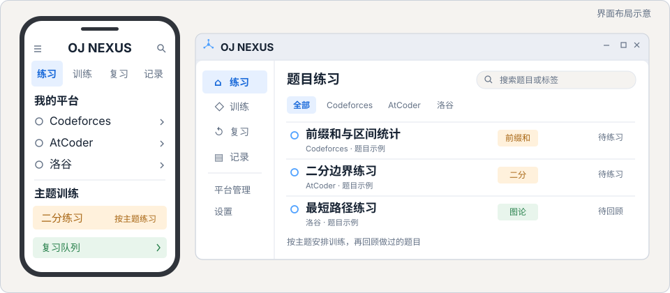
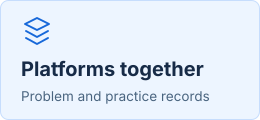
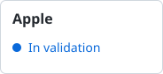

Reusable README example · Public project information from OJ NEXUS

<h1 align="center">OJ NEXUS</h1>

<strong>A competitive programming study client</strong> Connect your OJs and organize practice records, training and review

<a href="README.md">简体中文</a> · <a href="README.en.md">English</a>

  
  
  
  

<a href="https://github.com/tangyixiao/OJ-NEXUS/releases/download/v1.0.4/OJ-NEXUS-v1.0.4.apk"><strong>Download for Android</strong></a> · <a href="https://github.com/tangyixiao/OJ-NEXUS#readme">Documentation</a> · <a href="https://github.com/tangyixiao/OJ-NEXUS/issues/new">Report an issue</a>

  <picture>
    <source media="(prefers-color-scheme: dark)" srcset="assets/hero-dark.svg">
    
  </picture>
   Illustrated interface layout · Not a captured application screenshot

  <picture><source media="(prefers-color-scheme: dark)" srcset="assets/feature-platforms-en-dark.svg"></picture>
  <picture><source media="(prefers-color-scheme: dark)" srcset="assets/feature-training-en-dark.svg"></picture>
  <picture><source media="(prefers-color-scheme: dark)" srcset="assets/feature-review-en-dark.svg"></picture>

## Development status

[Read the roadmap](https://github.com/tangyixiao/OJ-NEXUS/blob/main/docs/LONG_RANGE_PLAN_121_220.md)

  <a href="https://github.com/tangyixiao/OJ-NEXUS/releases/tag/v1.0.4"><picture><source media="(prefers-color-scheme: dark)" srcset="assets/status-android-dark.svg"></picture></a>
  <a href="https://github.com/tangyixiao/OJ-NEXUS/releases/tag/windows-v0.1.2-rc.1"><picture><source media="(prefers-color-scheme: dark)" srcset="assets/status-windows-dark.svg"></picture></a>
  <a href="https://github.com/tangyixiao/OJ-NEXUS/releases/tag/linux-v0.1.1-rc.1"><picture><source media="(prefers-color-scheme: dark)" srcset="assets/status-linux-dark.svg"></picture></a>
  <a href="https://github.com/tangyixiao/OJ-NEXUS/actions/workflows/apple.yml"><picture><source media="(prefers-color-scheme: dark)" srcset="assets/status-apple-dark.svg"></picture></a>

Android has a stable release. Windows and Linux are prereleases. Apple remains in source and CI validation. These are publication stages; platform capabilities and limitations are described in each release's notes.

## Get started

1. Choose the package for your platform below and read its release notes
2. Follow the project's documentation for installation and platform configuration
3. Start with one practice session, then organize records, training and review

| Platform | Version | Stage | Download and notes |
| --- | --- | --- | --- |
| Android | v1.0.4 | Stable | [APK](https://github.com/tangyixiao/OJ-NEXUS/releases/download/v1.0.4/OJ-NEXUS-v1.0.4.apk) · [Release notes](https://github.com/tangyixiao/OJ-NEXUS/releases/tag/v1.0.4) |
| Windows | v0.1.2-rc.1 | Preview | [ZIP and release notes](https://github.com/tangyixiao/OJ-NEXUS/releases/tag/windows-v0.1.2-rc.1) |
| Linux | v0.1.1-rc.1 | Preview | [DEB and release notes](https://github.com/tangyixiao/OJ-NEXUS/releases/tag/linux-v0.1.1-rc.1) |

Checksums are supplied on the corresponding release pages. Stages were checked on 2026-11-09. Stars and the chart below come from external services and may be cached. The Chinese UI illustration does not claim an English-language application interface.

## Star History

<picture>
  <source media="(prefers-color-scheme: dark)" srcset="https://api.star-history.com/chart?repos=tangyixiao/OJ-NEXUS&amp;type=date&amp;theme=dark&amp;legend=top-left">
  
</picture>

[Interactive chart](https://www.star-history.com/?repos=tangyixiao%2FOJ-NEXUS&type=date) · [View stars on GitHub](https://github.com/tangyixiao/OJ-NEXUS/stargazers)

[Usage and help](https://github.com/tangyixiao/OJ-NEXUS#readme) · [Development docs](https://github.com/tangyixiao/OJ-NEXUS/tree/main/docs) · [Contributing](https://github.com/tangyixiao/.github/blob/main/CONTRIBUTING.md) · [Project license](https://github.com/tangyixiao/OJ-NEXUS/blob/main/LICENSE)

---

This is a standalone README example. Interface art is an original illustration, not runtime evidence. This directory does not supply the application's code or installers. [Adoption and replacement guide](ADOPTING.md)
