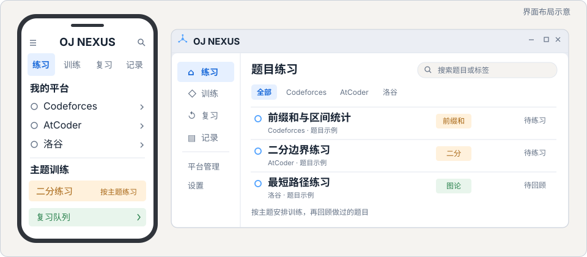

可复用 README 样板 · 使用 OJ NEXUS 的公开项目信息

<h1 align="center">OJ NEXUS</h1>

<strong>竞赛编程学习客户端</strong> 连接多个 OJ，整理练习记录、训练与复习

<a href="README.md">简体中文</a> · <a href="README.en.md">English</a>

  
  
  
  

<a href="https://github.com/tangyixiao/OJ-NEXUS/releases/download/v1.0.4/OJ-NEXUS-v1.0.4.apk"><strong>下载 Android 版</strong></a> · <a href="https://github.com/tangyixiao/OJ-NEXUS#readme">使用文档</a> · <a href="https://github.com/tangyixiao/OJ-NEXUS/issues/new">报告问题</a>

  <picture>
    <source media="(prefers-color-scheme: dark)" srcset="assets/hero-dark.svg">
    
  </picture>
   界面布局示意 · 非应用实测截图

  <picture><source media="(prefers-color-scheme: dark)" srcset="assets/feature-platforms-dark.svg"></picture>
  <picture><source media="(prefers-color-scheme: dark)" srcset="assets/feature-training-dark.svg"></picture>
  <picture><source media="(prefers-color-scheme: dark)" srcset="assets/feature-review-dark.svg"></picture>

## 开发进度

[查看开发路线图](https://github.com/tangyixiao/OJ-NEXUS/blob/main/docs/LONG_RANGE_PLAN_121_220.md)

  <a href="https://github.com/tangyixiao/OJ-NEXUS/releases/tag/v1.0.4"><picture><source media="(prefers-color-scheme: dark)" srcset="assets/status-android-dark.svg"></picture></a>
  <a href="https://github.com/tangyixiao/OJ-NEXUS/releases/tag/windows-v0.1.2-rc.1"><picture><source media="(prefers-color-scheme: dark)" srcset="assets/status-windows-dark.svg"></picture></a>
  <a href="https://github.com/tangyixiao/OJ-NEXUS/releases/tag/linux-v0.1.1-rc.1"><picture><source media="(prefers-color-scheme: dark)" srcset="assets/status-linux-dark.svg"></picture></a>
  <a href="https://github.com/tangyixiao/OJ-NEXUS/actions/workflows/apple.yml"><picture><source media="(prefers-color-scheme: dark)" srcset="assets/status-apple-dark.svg"></picture></a>

Android 已有稳定版；Windows、Linux 为预发布版本；Apple 仍在源码与 CI 验证阶段。这里显示发布阶段，具体平台能力与已知限制以各自发行说明为准。

## 开始使用

1. 按下表选择对应平台的安装包，先阅读发行说明
2. 按项目使用文档完成安装与平台配置
3. 从一次练习开始，再整理记录、训练和复习安排

| 平台 | 版本 | 发布阶段 | 下载与说明 |
| --- | --- | --- | --- |
| Android | v1.0.4 | 稳定版 | [APK](https://github.com/tangyixiao/OJ-NEXUS/releases/download/v1.0.4/OJ-NEXUS-v1.0.4.apk) · [发行说明](https://github.com/tangyixiao/OJ-NEXUS/releases/tag/v1.0.4) |
| Windows | v0.1.2-rc.1 | 预览版 | [ZIP 与发行说明](https://github.com/tangyixiao/OJ-NEXUS/releases/tag/windows-v0.1.2-rc.1) |
| Linux | v0.1.1-rc.1 | 预览版 | [DEB 与发行说明](https://github.com/tangyixiao/OJ-NEXUS/releases/tag/linux-v0.1.1-rc.1) |

各版本的校验和随对应发行页提供。阶段信息核对于 2026-11-09；Stars 与下方图表由外部服务生成，可能受服务缓存影响。

## Star History

<picture>
  <source media="(prefers-color-scheme: dark)" srcset="https://api.star-history.com/chart?repos=tangyixiao/OJ-NEXUS&amp;type=date&amp;theme=dark&amp;legend=top-left">
  
</picture>

[查看交互图表](https://www.star-history.com/?repos=tangyixiao%2FOJ-NEXUS&type=date) · [直接查看 GitHub Stars](https://github.com/tangyixiao/OJ-NEXUS/stargazers)

[使用与常见问题](https://github.com/tangyixiao/OJ-NEXUS#readme) · [开发文档](https://github.com/tangyixiao/OJ-NEXUS/tree/main/docs) · [参与贡献](https://github.com/tangyixiao/.github/blob/main/CONTRIBUTING.md) · [项目许可证](https://github.com/tangyixiao/OJ-NEXUS/blob/main/LICENSE)

---

这是独立的 README 展示样板。这里的界面图是原创示意，不是应用运行证据；本目录不提供应用源码或安装包。[采用与替换说明](ADOPTING.md)
